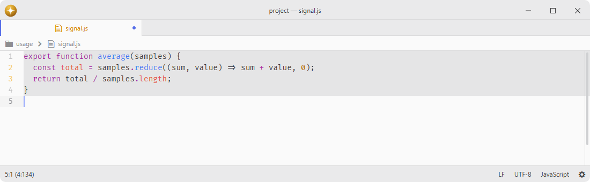

# whitespace

Strips trailing whitespace and adds a trailing newline when an editor is saved.

Fork of [pulsar-edit/pulsar](https://github.com/pulsar-edit/pulsar) (`packages/whitespace`).

## Features

- **Trailing whitespace removal**: strips whitespace from the ends of lines on save.
- **Trailing newline**: ensures the buffer ends with a single trailing newline.
- **Tab and space conversion**: convert between tabs and spaces on demand.
- **Markdown-aware**: optionally keeps the double-space line breaks Markdown relies on.
- **Scoped settings**: enable or disable behavior per language through syntax-scoped properties.



## Installation

To install `whitespace` search for it in the Install pane of the Lumine settings, or run the command `lumine --install lumine-code/whitespace`.

## Commands

Commands available in `lumine-text-editor:not([mini]):not([readonly])`:

Commands act on the editor they were dispatched from. Application-menu and command-palette actions use the focus captured before opening and remain unavailable on other surfaces.

- `whitespace:remove-trailing-whitespace`: remove trailing whitespace from the editor,
- `whitespace:save-with-trailing-whitespace`: save the editor without stripping trailing whitespace,
- `whitespace:save-without-trailing-whitespace`: strip trailing whitespace and then save,
- `whitespace:convert-tabs-to-spaces`: convert leading tabs to spaces,
- `whitespace:convert-spaces-to-tabs`: convert leading spaces to tabs,
- `whitespace:convert-all-tabs-to-spaces`: convert all tabs to spaces.

## Configuration

Automatic cleanup is suspended when the editor's grammar is **None**, so saving a large file preserves its text without scanning it. Explicit whitespace commands remain available. Selecting a grammar resumes automatic cleanup.

To disable or enable features for a certain language, use syntax-scoped properties in your `config.json`. For example:

```json
{
  ".slim.text": {
    "whitespace": {
      "removeTrailingWhitespace": false
    }
  }
}
```

You find the `scope` at the top of a grammar package's settings view. For `.source.jade`, `.source.diff`, `.source.pug` and `.source.patch`, removing trailing whitespace is disabled by default.

## Contributing

Got ideas to make this package better, found a bug, or want to help add new features? Just drop your thoughts on GitHub. Any feedback is welcome!
